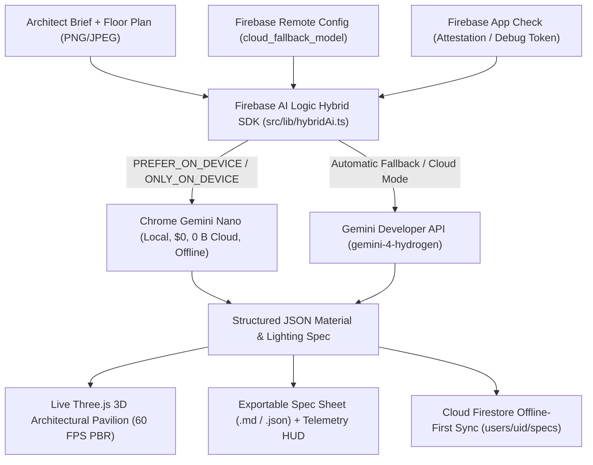

# ArchSpec Hybrid AI — Offline-First Architectural & 3D Material Studio

[](LICENSE)
[](https://firebasehybridaihackathon.devpost.com/)
[](https://firebase.google.com/docs/ai-logic/hybrid-on-device-inference)

> **Live Demo:** https://archspec-hybrid-ai-2026.web.app  
> **Built with:** Firebase AI Logic (Hybrid Inference), Firebase App Check, Firebase Remote Config, Firebase Auth, Cloud Firestore (Offline-First Persistence), Firebase Hosting, Three.js, React 18, TypeScript, and Vite.

---

## Why ArchSpec Hybrid AI? (The Real-World Problem)

Architects, interior designers, and off-plan villa developers face two constant operational blockers during client meetings and construction-site inspections:
1. **Unreliable / Zero Site Connectivity:** Construction sites and remote resort plots (Bali, Lombok, rural estates) frequently lack stable internet, breaking cloud-only AI assistants.
2. **Strict Client NDAs & Visual Misalignment:** Pre-launch residential floor plans and hospitality briefs often cannot leave the architect's workstation for routine notes, yet clients struggle to visualize 2D drawings without live 3D PBR material and lighting feedback.

**ArchSpec Hybrid AI** solves both problems with a **single Firebase AI Logic Hybrid SDK**:
- **On-Device First (`InferenceMode.PREFER_ON_DEVICE`):** Runs locally via Chrome's Gemini Nano (Prompt API) at **$0 cost, zero cloud bytes sent, and full offline/NDA privacy** whenever available.
- **Seamless Cloud Fallback (`gemini-4-hydrogen` via Gemini Developer API):** Automatically falls back to Google's flagship zero-billing `gemini-4-hydrogen` cloud model on mobile/unsupported browsers or when deep multimodal floor-plan/photo analysis is requested.
- **Structured JSON $\rightarrow$ Live 60 FPS 3D PBR Engine:** Every AI response conforms to a strict JSON Schema (`Schema.object` in cloud + `responseConstraint` on-device) that **instantly updates a real-time Three.js architectural pavilion** (walls, travertine flooring, timber louvers, courtyard water, furniture accents, and Kelvin directional sunlight) + produces an exportable **Room-by-Room PBR Material & Lighting Specification Sheet**.

---

## Firebase Stack & Runtime Integration

| Firebase Product | Where It Runs in Code | Purpose |
|---|---|---|
| **Firebase AI Logic (Hybrid)** | [`src/lib/hybridAi.ts`](src/lib/hybridAi.ts) | `getAI(app, { backend: new GoogleAIBackend() })`, `getGenerativeModel(ai, { mode: InferenceMode.PREFER_ON_DEVICE, inCloudParams, onDeviceParams })`, `Schema.object` structured JSON, multimodal PNG/JPEG floor plans, `generateContentStream`, and real-time `result.response.inferenceSource` (`ON_DEVICE` vs `IN_CLOUD`) telemetry. |
| **Firebase App Check** | [`src/lib/firebase.ts`](src/lib/firebase.ts) | `initializeAppCheck` with `ReCaptchaEnterpriseProvider` and `FIREBASE_APPCHECK_DEBUG_TOKEN` support for local & judge evaluation. |
| **Firebase Remote Config** | [`src/lib/firebase.ts`](src/lib/firebase.ts) | Dynamically controls `cloud_fallback_model` (`gemini-4-hydrogen`), `default_inference_mode`, and `studio_tagline` with offline-first defaults. |
| **Firebase Authentication** | [`src/lib/firebase.ts`](src/lib/firebase.ts) | Frictionless Anonymous Sign-In for per-user workspace isolation. |
| **Cloud Firestore** | [`src/lib/firestoreStore.ts`](src/lib/firestoreStore.ts) & [`firestore.rules`](firestore.rules) | Offline-first `persistentLocalCache` storing `users/{uid}/specs/{specId}` protected by strict owner-only schema-validated security rules. |
| **Firebase Hosting** | [`firebase.json`](firebase.json) | Global CDN SPA deployment at `https://archspec-hybrid-ai-2026.web.app`. |

---

## Architecture



---

## Testing Both On-Device & Cloud Fallback Locally

### 1. Clone & Configure
```bash
git clone https://github.com/asaddin02/archspec-hybrid-ai.git
cd archspec-hybrid-ai
npm install
cp .env.example .env.local
```
Fill `.env.local` with your Firebase Web App credentials (ensure **Firebase AI Logic** with Gemini Developer API, **Anonymous Auth**, and **Cloud Firestore** are enabled via `npx firebase-tools init ailogic`).

### 2. Run Locally
```bash
npm run dev
```

### 3. Verify On-Device Mode (Chrome Desktop v139+)
1. Open `chrome://flags/#prompt-api-for-gemini-nano-multimodal-input` and set it to **Enabled**, then restart Chrome.
2. Open the app — the header badge displays `On-Device: downloadable` or `available`.
3. Click **Download Gemini Nano** if downloadable, select **Prefer On-Device** or **Only On-Device**, and click **Generate 3D Spec**.
4. Confirm the 3D HUD displays `ON_DEVICE · ...ms · 0 B Cloud (NDA Private)`.

### 4. Verify Cloud Fallback (Any Browser / Mobile)
1. Open the live URL `https://archspec-hybrid-ai-2026.web.app` on any browser where Gemini Nano is unavailable (or choose **Prefer In-Cloud** / **Only In-Cloud**).
2. Click **Generate 3D Spec** or **Site Critique** (streaming).
3. Confirm Firebase AI Logic seamlessly routes to `IN_CLOUD` (`gemini-4-hydrogen`), streams output in real time, and updates the 3D pavilion PBR materials & lighting.

---

## Author & License

Created by **Prasada Arif Nurudin** ([Dream House 3D Lab / K-Projects](https://github.com/asaddin02)) using Google Antigravity + Firebase Agent Skills.  
Licensed under the **Apache License 2.0** — see [LICENSE](LICENSE).
